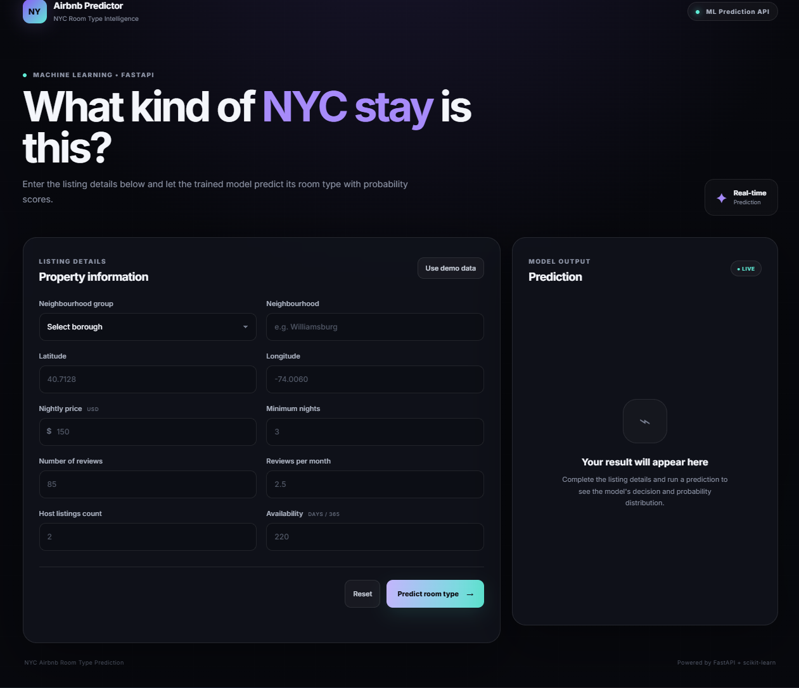
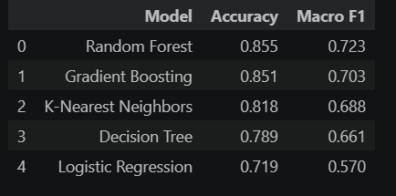

# NYC Airbnb Room Type Prediction

An end-to-end multiclass machine learning application that predicts the
room type of an Airbnb listing in New York City from listing attributes.
The project combines a scikit-learn classification pipeline, a FastAPI
prediction API, and an interactive HTML, CSS, and JavaScript frontend.

## Project Overview

The application accepts property and listing details and predicts one of
three room categories:

-   Entire home/apt
-   Private room
-   Shared room

The interface displays the predicted room type, the top-class
probability, and a probability breakdown across all three classes.

## Application Preview

### 1. Prediction interface

Users can enter listing details manually or load the example values
using the demo-data control.



### 2. Prediction result

After submitting the listing details, the application displays the
predicted room type and class probability distribution.


> Add the two application screenshots to `assets/screenshots/` using the
> filenames shown above.

## Input Features

The frontend collects the following 10 listing features:

  Feature               Description
  --------------------- ----------------------------------------
  Neighbourhood group   NYC borough
  Neighbourhood         Specific neighbourhood
  Latitude              Property latitude
  Longitude             Property longitude
  Price                 Nightly listing price in USD
  Minimum nights        Minimum booking duration
  Number of reviews     Total number of reviews
  Reviews per month     Average monthly review count
  Host listings count   Number of listings managed by the host
  Availability 365      Number of available days in a year

## Machine Learning Workflow

The project follows an end-to-end supervised learning workflow:

1.  Define the room-type prediction problem as a multiclass
    classification task.
2.  Inspect and understand the Airbnb listing dataset.
3.  Perform exploratory data analysis to examine feature distributions,
    relationships, and target-class frequencies.
4.  Prepare the input features through data cleaning and preprocessing.
5.  Train multiple classification algorithms.
6.  Evaluate candidate models using accuracy and macro F1-score.
7.  Compare model performance and select a model.
8.  Serialize the trained model/pipeline for inference.
9.  Integrate the model with a FastAPI backend.
10. Connect the backend to the browser-based frontend.

## Model Performance

Five classification algorithms were evaluated using Accuracy and Macro F1-score.

| Model | Accuracy | Macro F1 |
|---|---:|---:|
| Random Forest | **85.5%** | **72.3%** |
| Gradient Boosting | 85.1% | 70.3% |
| K-Nearest Neighbors | 81.8% | 68.8% |
| Decision Tree | 78.9% | 66.1% |
| Logistic Regression | 71.9% | 57.0% |

### Model Performance Comparison

The following visualization compares the performance of the five classification models.



**Model Selection:** Random Forest achieved the highest reported Accuracy (85.5%) and Macro F1-score (72.3%) among the evaluated models.

### Confusion Matrix

The confusion matrix below shows the class-wise prediction counts. Rows
represent actual classes and columns represent predicted classes.


  Actual  Predicted     Entire home/apt   Private room   Shared room
  ------------------- ----------------- -------------- -------------
  Entire home/apt                 6,686            937             0
  Private room                      963          5,692            43
  Shared room                        36            161           151

### Class-wise observations

-   The model identifies the two larger room categories substantially
    better than the shared-room category.
-   Shared-room recall from the displayed confusion matrix is
    approximately **43.4%** (151 correctly classified out of 348 actual
    shared-room examples).
-   Most shared-room misclassifications are predicted as private rooms
    (161 cases).
-   This indicates that overall accuracy alone does not fully describe
    model performance; class-wise metrics and macro F1 are important.

**Metric consistency note:** The supplied model-comparison table reports
Random Forest macro F1 of **0.723**, while recalculating macro F1 from
the displayed confusion matrix gives approximately **0.758**. The
accuracy calculated from that matrix is approximately **0.854**. Verify
that the comparison table and confusion matrix were generated from the
same test split, model version, and predictions before treating these
figures as one consistent evaluation. The values above are kept as
supplied rather than silently reconciled.

## Application Architecture

``` text
        User
          |
          v
  HTML / CSS / JavaScript
       Frontend
          |
          | HTTP request
          v
     FastAPI Backend
          |
          v
   Pydantic Validation
          |
          v
  Serialized ML Pipeline
          |
          v
   Room Type Prediction
          |
          v
     JSON Response
          |
          v
  Prediction displayed
     in Frontend
```

## Technology Stack

  Area                   Tools
  ---------------------- -----------------------
  Programming language   Python
  Data analysis          Pandas, NumPy
  Visualization          Matplotlib, Seaborn
  Machine learning       Scikit-learn
  Model serialization    Joblib
  Backend API            FastAPI
  Request validation     Pydantic
  Frontend               HTML, CSS, JavaScript
  Version control        Git, GitHub

## Run Locally

### Prerequisites

-   Python installed
-   Git
-   pip

### 1. Clone the repository

``` bash
git clone https://github.com/Aryan-1105/NYC-Airbnb-Room-Type-Prediction.git
cd NYC-Airbnb-Room-Type-Prediction
```

### 2. Create and activate a virtual environment

**Windows**

``` bash
python -m venv venv
venv\Scripts\activate
```

**macOS / Linux**

``` bash
python -m venv venv
source venv/bin/activate
```

### 3. Install dependencies

``` bash
pip install -r requirements.txt
```

### 4. Start the FastAPI server

If the FastAPI application object is named `app` in `main.py`, run:

``` bash
uvicorn main:app --reload
```

If your entry-point module or application variable has a different name,
adjust `main:app` to match your code.

### 5. Open the API documentation

Visit:

``` text
http://127.0.0.1:8000/docs
```

FastAPI's Swagger UI provides interactive documentation for the
available API routes.

### 6. Open the frontend

Serve the frontend using the method configured in the project. If it is
a standalone static frontend, open its HTML entry page or use a local
development server. Ensure the frontend's API base URL points to the
running FastAPI server.

## API Prediction Flow

The prediction flow is:

1.  The frontend gathers the listing attributes.
2.  It sends the input to the FastAPI prediction endpoint.
3.  Pydantic validates the request data.
4.  The backend passes the validated features to the saved model.
5.  The model returns a predicted room category and class probabilities,
    as implemented by the API.
6.  The frontend renders the prediction and probability breakdown.

For the exact request schema and endpoint details, refer to the FastAPI
source code and the interactive `/docs` page.

## Limitations and Future Improvements

The confusion matrix highlights weaker recall for the shared-room class.
Possible next steps include:

-   Investigate class distribution and class-specific errors.
-   Evaluate class weighting and resampling techniques using training
    data only.
-   Use stratified cross-validation.
-   Compare models using macro F1 and per-class precision and recall,
    not accuracy alone.
-   Tune hyperparameters and validate improvements on a held-out test
    set.
-   Add automated API tests and structured error handling.
-   Monitor prediction behaviour after deployment.

Any improvement should be confirmed with a consistent evaluation
protocol and held-out data.

## Author

**Aryan Kumar Sahoo**\
B.Tech, Mechanical Engineering\
National Institute of Technology Rourkela

-   **GitHub:** [Aryan-1105](https://github.com/Aryan-1105)
-   **LinkedIn:** [Aryan Kumar
    Sahoo](https://www.linkedin.com/in/aryan-kumar-sahoo/)
-   **Project:** [NYC Airbnb Room Type
    Prediction](https://github.com/Aryan-1105/NYC-Airbnb-Room-Type-Prediction)

------------------------------------------------------------------------

If you find this project useful, consider giving the repository a ⭐.
